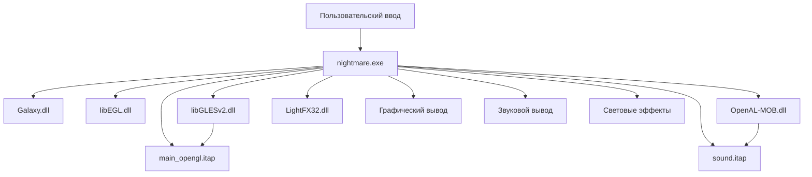
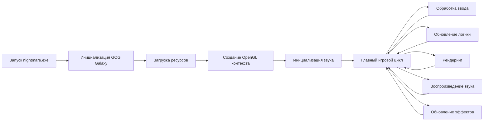

# 🎮 Neverending Nightmares

## 📋 Обзор проекта

**Neverending Nightmares** - это психологический хоррор-игра, ты Томас, просыпающийся от одного ужаса в другой, исследуя мрачные особняки, кладбища и психиатрические клиники, избегая монстров и раскрывая тайны.
Старенькая и обычная игрушка по геймплею, но очень хорошая за счёт своего сюжета.

## 🚀 Начало игры

Чтобы начать играть, склонируйте репозиторий:
```bash
git clone https://github.com/QuestGuideRF/nightmare.git
```

### Быстрый запуск
1. Перейдите в папку проекта
2. Запустите `nightmare.exe`
3. Наслаждайтесь игрой!

## 📁 1. Структура проекта

```
Neverending Nightmares/
├── nightmare.exe              # Основной исполняемый файл игры
├── main_opengl.itap          # Ресурсы графики (274MB)
├── sound.itap                # Ресурсы звука (104MB)
├── Galaxy.dll                # Библиотека GOG Galaxy
├── libEGL.dll               # OpenGL библиотека
├── libGLESv2.dll            # OpenGL библиотека
├── OpenAL-MOB.dll           # Библиотека для работы со звуком
├── LightFX32.dll            # Библиотека световых эффектов
└── support.ico              # Иконка поддержки
```

## 📄 2. Описание файлов

### 🎯 Основные файлы игры

#### `nightmare.exe` (3.6MB)
- **Назначение**: Главный исполняемый файл игры
- **Ключевые функции**:
  - Инициализация игрового движка
  - Управление игровым циклом
  - Обработка пользовательского ввода
  - Рендеринг графики
- **Связи**: Зависит от всех DLL библиотек и ресурсных файлов
- **Логика**: Точка входа в приложение, управляет всем игровым процессом

#### `main_opengl.itap` (274MB)
- **Назначение**: Основной ресурсный файл с графическими данными
- **Содержимое**:
  - Текстуры и материалы
  - 3D модели
  - Анимации
  - UI элементы
- **Формат**: Собственный формат ITAP (Infinitap Archive)
- **Связи**: Загружается основным исполняемым файлом

#### `sound.itap` (104MB)
- **Назначение**: Ресурсный файл со звуковыми данными
- **Содержимое**:
  - Фоновая музыка
  - Звуковые эффекты
  - Аудио диалоги
  - Атмосферные звуки
- **Формат**: Собственный формат ITAP
- **Связи**: Обрабатывается через OpenAL-MOB.dll

### 🔧 Библиотеки и зависимости

#### `Galaxy.dll` (11MB)
- **Назначение**: Интеграция с платформой GOG Galaxy
- **Функции**:
  - Аутентификация пользователя
  - Синхронизация достижений
  - Облачные сохранения
  - Обновления игры
- **Связи**: Используется основным исполняемым файлом

#### `libEGL.dll` (13KB)
- **Назначение**: OpenGL ES EGL библиотека
- **Функции**:
  - Инициализация OpenGL контекста
  - Управление окном и поверхностями
  - Совместимость с различными графическими API
- **Связи**: Используется libGLESv2.dll

#### `libGLESv2.dll` (1.8MB)
- **Назначение**: OpenGL ES 2.0 библиотека
- **Функции**:
  - Рендеринг 3D графики
  - Шейдеры и материалы
  - Текстурирование
  - Освещение
- **Связи**: Основная графическая библиотека

#### `OpenAL-MOB.dll` (638KB)
- **Назначение**: Библиотека для работы со звуком
- **Функции**:
  - Воспроизведение звука
  - 3D позиционирование звука
  - Управление громкостью
  - Эффекты реверберации
- **Связи**: Обрабатывает звуковые данные из sound.itap

#### `LightFX32.dll` (22KB)
- **Назначение**: Библиотека световых эффектов
- **Функции**:
  - Управление RGB подсветкой
  - Синхронизация с игровыми событиями
  - Атмосферные эффекты
- **Связи**: Дополнительная библиотека для иммерсивности

#### `support.ico` (61KB)
- **Назначение**: Иконка для системы поддержки
- **Использование**: Отображается в системных диалогах

## 🏗️ 3. Архитектура проекта

### Общая структура



### Потоки данных



## 📚 4. Библиотеки/фреймворки

| Библиотека | Назначение | Где используется |
|------------|------------|------------------|
| **GOG Galaxy SDK** | Интеграция с платформой | Аутентификация, облачные сохранения |
| **OpenGL ES 2.0** | Графический рендеринг | Отображение 3D графики и UI |
| **OpenAL** | Звуковая система | Воспроизведение музыки и эффектов |
| **LightFX** | Световые эффекты | RGB подсветка для иммерсивности |
| **ITAP Engine** | Ресурсная система | Управление игровыми ресурсами |

## 🎯 5. Точка входа и запуск

### Последовательность запуска:

1. **Инициализация системы**
   - Проверка системных требований
   - Инициализация GOG Galaxy
   - Создание лог-файлов

2. **Загрузка ресурсов**
   - Распаковка `main_opengl.itap`
   - Загрузка `sound.itap`
   - Инициализация текстур и моделей

3. **Инициализация графики**
   - Создание OpenGL контекста
   - Настройка шейдеров
   - Инициализация камеры

4. **Инициализация звука**
   - Настройка OpenAL
   - Загрузка аудио файлов
   - Настройка 3D позиционирования

5. **Главный цикл**
   - Обработка событий
   - Обновление игровой логики
   - Рендеринг кадра

## 🔧 6. Архитектурные особенности

### Нестандартные решения

1. **Собственный формат ITAP**
   - Оптимизирован для быстрой загрузки
   - Сжатие ресурсов
   - Защита от модификации

2. **Модульная архитектура**
   - Разделение графики, звука и логики
   - Независимые библиотеки
   - Легкость обновления компонентов

3. **Кроссплатформенность**
   - Использование OpenGL ES
   - Совместимость с различными системами
   - Минимальные зависимости

### Причины выбора архитектуры

1. **Производительность**
   - Нативная компиляция
   - Оптимизированные библиотеки
   - Эффективное использование ресурсов

2. **Надежность**
   - Проверенные библиотеки
   - Обработка ошибок
   - Стабильная работа

3. **Расширяемость**
   - Модульная структура
   - Возможность добавления контента
   - Поддержка обновлений

## 🎮 Системные требования

### Минимальные требования:
- **ОС**: Windows 7/8/10/11
- **Процессор**: Intel Core i3 или AMD эквивалент
- **Память**: 4 GB RAM
- **Графика**: OpenGL 3.0 совместимая
- **Место на диске**: 400 MB

### Рекомендуемые требования:
- **ОС**: Windows 10/11
- **Процессор**: Intel Core i5 или AMD эквивалент
- **Память**: 8 GB RAM
- **Графика**: OpenGL 4.0 совместимая
- **Место на диске**: 400 MB

## 🐛 Устранение неполадок

### Частые проблемы:

1. **Игра не запускается**
   - Проверьте наличие всех DLL файлов
   - Убедитесь в совместимости с системой
   - Обновите драйверы видеокарты

2. **Проблемы со звуком**
   - Проверьте настройки OpenAL
   - Убедитесь в работоспособности аудио системы

3. **Низкая производительность**
   - Закройте фоновые приложения
   - Обновите драйверы
   - Проверьте настройки графики

Подпись относится к текущей версии проекта.

---

Автор: legenda  
Telegram: [@LEGENDA_SD](https://t.me/LEGENDA_SD)
